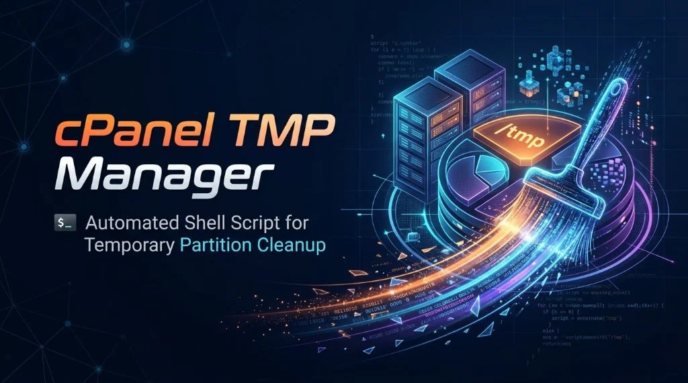

# cPanel TMP Manager (`tmp-manager.sh`)

Readme: [EN](README.md)

 



Utilitário Bash moderno e não-destrutivo para monitorar uso de disco e inodes em `/tmp` e `/var/tmp`, auditar hardening de montagem (`noexec`, `nosuid`, `nodev` e sticky bit `1777`), executar limpeza segura sem downtime (protegendo sockets ativos e arquivos abertos) e redimensionar `tmpfs` ou `/usr/tmpDSK` (`/scripts/securetmp`) em servidores Linux e cPanel/WHM.

## Funcionalidades (v2.0.0)

* **Telemetria Completa e Auditoria de Hardening (`--status`):** Exibe origem da montagem, tipo de filesystem, uso de disco (`%`), uso de inodes (`%`), maiores consumidores, permissões (`1777`) e flags `noexec`/`nosuid`/`nodev`.
* **Limpeza Segura Sem Downtime (`--clean`):** Remove arquivos expirados em `/tmp` e `/var/tmp` usando `find` nativo (sem depender de `tmpwatch`), protegendo `mysql.sock`, `*.sock`, `systemd-private-*`, `lshttpd`, `hsperfdata_*` e arquivos atualmente abertos por processos (`fuser`).
* **Pronto para `cron` e Automação:** Suporta `--dry-run`, `--yes`, `--force`, `--threshold <pct>`, `--age-hours <h>` e saída estruturada `-o json` com exit code `2` quando o uso atinge o threshold.
* **Resize Seguro (`--resize`):** Redimensiona `tmpfs` ao vivo via `mount -o remount,size=...` sem desmontar nem parar o MySQL/MariaDB, ou aciona `/scripts/securetmp --auto` quando solicitado explicitamente.

## Pré-requisitos

* `bash` 4.0+
* Utilitários padrão Linux (`df`, `du`, `find`, `stat`, `awk`)
* Privilégios de `root` para `--clean` e `--resize` (`--status` e `--dry-run` rodam somente leitura)
* Opcional: `fuser` (proteção de arquivos abertos), `python3` (`-o json`)

## Exemplos Práticos

**Auditar uso de disco/inodes e flags de hardening em `/tmp`:**
```bash
./tmp-manager.sh --status
```

**Simular limpeza de arquivos com mais de 12 horas sem apagar nada:**
```bash
./tmp-manager.sh --clean --dry-run --age-hours 12 --force
```

**Limpeza automática via cron quando o uso atingir 80%:**
```bash
sudo ./tmp-manager.sh --clean --threshold 80 --age-hours 12 -y
```

**Redimensionar partição `tmpfs` em `/tmp` ao vivo para 2048M:**
```bash
sudo ./tmp-manager.sh --resize 2048M -y
```

## Exemplo de Saída Real

```text
================================================================================
 CPANEL TMP MANAGER v2.0.0 - [cpanel-test.local]
================================================================================
 Mount Point  : /tmp (overlay, overlay)
 Disk Usage   : 75G / 99G (80% used, 20G avail) | Threshold: 80%
 Inode Usage  : 14%
 Permissions  : 1777 (expected: 1777)
 Mount Flags  : inherited
 Hardening    : NOT FULL HARDENED (check noexec,nosuid,nodev)
 Health State : ALERT
--------------------------------------------------------------------------------
 Top Consumers in /tmp:
   4.0K	/tmp/mariadb-test.log
================================================================================

================================================================================
 CPANEL TMP MANAGER v2.0.0 - CLEANUP SUMMARY
================================================================================
 Age Filter           : > 12 hour(s)
 Files Removed        : 2
 Open Files Protected : 0
 Space Reclaimed      : 2.00 MB
================================================================================
```

## Tutorial Detalhado

Confira o guia completo no blog: [**Como Proteger `/tmp` Corretamente em um Servidor cPanel**](https://perciocastelo.com.br/blog/secure-tmp-properly-on-a-cpanel-server.html)

## Licença

Este projeto é distribuído sob a licença [Apache License 2.0](LICENSE).

---
Autor: **Percio Castelo**  
Contato: [contato@perciocastelo.com.br](mailto:contato@perciocastelo.com.br)  
Website: [https://perciocastelo.com.br](https://perciocastelo.com.br)
