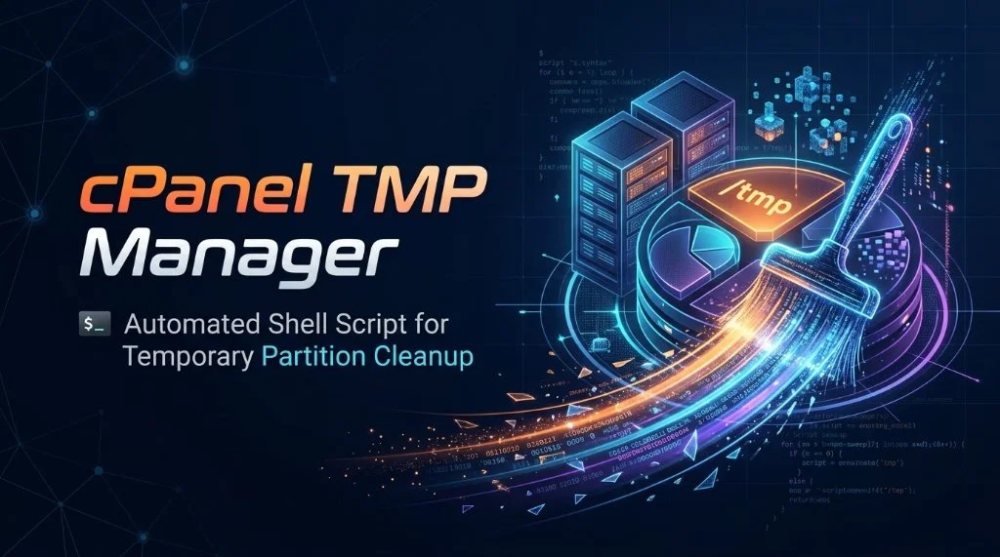

# cPanel TMP Manager (`tmp-manager.sh`)

Readme: [PT-BR](README-ptbr.md)

 



A modern, non-destructive Bash utility to monitor `/tmp` and `/var/tmp` disk and inode utilization, audit partition hardening (`noexec`, `nosuid`, `nodev`, `1777` sticky bit), perform zero-downtime age-based cleanup while protecting active sockets and open files, and safely resize `tmpfs` or cPanel `/usr/tmpDSK` (`/scripts/securetmp`) on Linux and cPanel/WHM servers.

## Features (v2.0.0)

* **Full Partition & Hardening Telemetry (`--status`):** Reports mount source, filesystem type, disk `%`, inode `%`, top consumers, sticky bit (`1777`), and `noexec`/`nosuid`/`nodev` mount flags.
* **Zero-Downtime Safe Cleanup (`--clean`):** Cleans expired files in `/tmp` and `/var/tmp` using native `find` (no `tmpwatch` required), protecting `mysql.sock`, `*.sock`, `systemd-private-*`, `lshttpd`, `hsperfdata_*`, and any file currently held open by a running process (`fuser`).
* **Non-Interactive & Cron-Ready:** Supports `--dry-run`, `--yes`, `--force`, `--threshold <pct>`, `--age-hours <h>`, and structured `-o json` output with exit code `2` when usage crosses the threshold.
* **Safe Resize (`--resize`):** Resizes `tmpfs` live via `mount -o remount,size=...` without unmounting or stopping MySQL/MariaDB, or runs cPanel's official `/scripts/securetmp --auto` when explicitly requested.

## Prerequisites

* `bash` 4.0+
* Standard Linux utilities (`df`, `du`, `find`, `stat`, `awk`)
* `root` privileges for `--clean` and `--resize` (`--status` and `--dry-run` work read-only)
* Optional: `fuser` (open-file protection), `python3` (`-o json`)

## Usage & Options

```text
cPanel TMP Manager (tmp-manager.sh) v2.0.0
Monitor, audit hardening, safely clean, and resize /tmp and /var/tmp on Linux/cPanel servers.

Usage:
  tmp-manager.sh [COMMAND] [OPTIONS]

Commands:
  -s, --status              Audit /tmp & /var/tmp disk/inode usage, mount flags, and top files (default)
  -c, --clean               Safely remove expired files in /tmp & /var/tmp (protects active sockets)
  -r, --resize [SIZE]       Resize tmpfs (e.g. 2048M) or rebuild cPanel /usr/tmpDSK via securetmp

Options:
  -t, --threshold <pct>     Alert/trigger usage threshold percentage (default: 80)
  -a, --age-hours <hours>   Minimum file age in hours for --clean (default: 12)
  -f, --force               Run --clean even when usage is below --threshold
  -n, --dry-run             Simulate cleanup or resize without modifying files/mounts
  -y, --yes                 Skip interactive confirmation prompts (for cron/automation)
  -o, --output <table|json> Output format (default: table)
  -q, --quiet               Suppress progress messages
      --no-color            Disable ANSI colors
```

## Practical Examples

**Audit `/tmp` disk/inode usage and hardening flags:**
```bash
./tmp-manager.sh --status
```

**Preview cleanup of files older than 12 hours without deleting anything:**
```bash
./tmp-manager.sh --clean --dry-run --age-hours 12 --force
```

**Automated cron cleanup when usage reaches 80%:**
```bash
sudo ./tmp-manager.sh --clean --threshold 80 --age-hours 12 -y
```

**Live resize a `tmpfs` `/tmp` partition to 2048M:**
```bash
sudo ./tmp-manager.sh --resize 2048M -y
```

## Real Output Example

```text
================================================================================
 CPANEL TMP MANAGER v2.0.0 - [cpanel-test.local]
================================================================================
 Mount Point  : /tmp (overlay, overlay)
 Disk Usage   : 75G / 99G (80% used, 20G avail) | Threshold: 80%
 Inode Usage  : 14%
 Permissions  : 1777 (expected: 1777)
 Mount Flags  : inherited
 Hardening    : NOT FULL HARDENED (check noexec,nosuid,nodev)
 Health State : ALERT
--------------------------------------------------------------------------------
 Top Consumers in /tmp:
   4.0K	/tmp/mariadb-test.log
================================================================================

================================================================================
 CPANEL TMP MANAGER v2.0.0 - CLEANUP SUMMARY
================================================================================
 Age Filter           : > 12 hour(s)
 Files Removed        : 2
 Open Files Protected : 0
 Space Reclaimed      : 2.00 MB
================================================================================
```

## Detailed Tutorial

Read the full walkthrough: [**How to Secure `/tmp` Properly on a cPanel Server**](https://perciocastelo.com.br/blog/secure-tmp-properly-on-a-cpanel-server.html)

## License

This project is licensed under the [Apache License 2.0](LICENSE).

---
Author: **Percio Castelo**  
Contact: [contato@perciocastelo.com.br](mailto:contato@perciocastelo.com.br)  
Website: [https://perciocastelo.com.br](https://perciocastelo.com.br)
